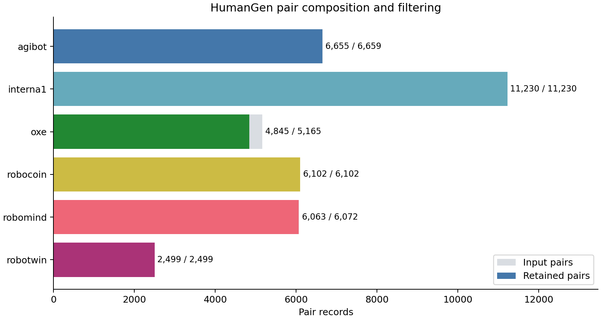
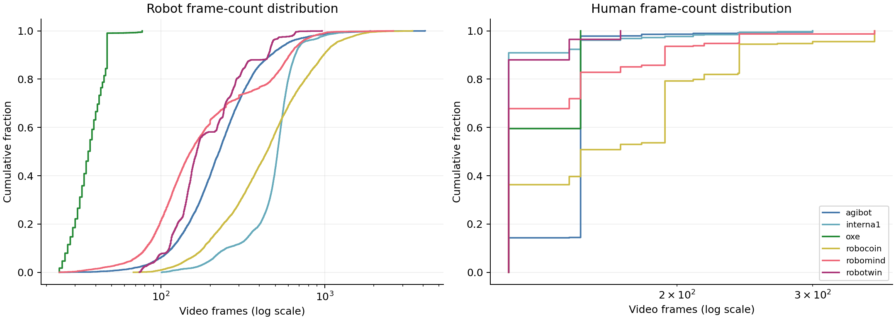
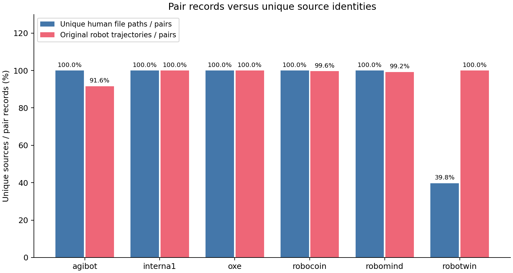

# HumanGen 人类–机器人视频配对数据分析报告

分析日期：2026-10-16。分析对象为本仓库已生成的 HumanGen 视觉 alignment 数据快照。

## 1. 主要结论

本次转换从 **37,727 条原始配对记录中保留 37,394 对，保留率 99.12%**。全部保留记录已通过转换阶段的可读首帧、最低帧数及机器人视频帧数一致性检查，具备接入现有视觉 alignment 加载器的数据条件。

正式训练和评估前，应优先处理以下问题：

- **划分独立验证集。** 当前 `task_paths_eval.json` 与训练配对使用相同数据。随机按配对行划分会引入已知来源重叠，RoboTwin 尤为明显。
- **区分配对规模与视频来源规模。** 37,394 对对应 35,889 个人类视频文件路径；RoboTwin 的 2,499 对仅对应 994 个人类视频文件。
- **区分帧数与时长。** 六个来源存在明显帧率差异，尤其是抽样中 OXE 的 5 FPS 与 RoboTwin 的 50 FPS。
- **确认训练取样配置。** 默认每卡微批次为 1，现有 collator 只能使用 `M=1`；梯度累积为 4 不会启用 `M=4`。
- **保留质量边界。** 原索引中有 2,758 对的 `physics_score=3`。数据读取成功、原始评分和模型训练效果是不同层面的证据。

## 2. 分析依据与统计口径

数据位置：

```text
原始数据：/AOSS/HumanGen/
转换输出：/data/250010175/icl/HOST/alignment/humangen_pairs/output/
```

本报告使用以下材料：

| 材料 | 用途与覆盖范围 |
|---|---|
| `output/pairs.jsonl` | 全部 37,394 对的来源、帧数、文本和新 episode 路径 |
| `output/summary.json`、`output/skipped.jsonl` | 37,727 条输入的转换与过滤统计 |
| 原始 `icl_configs/ICL_config_*.json` | 按来源及 `manifest_position` 关联，并核对 `run`、`sample`，恢复原始片段、轨迹与评分身份 |
| `output/validation_report.json` | 已完成的完整索引结构检查、12 对真实 train/eval 读取与帧解码、一个 Qwen 输入 batch |
| 本次媒体元数据抽样 | 每个来源随机抽 30 对，共 180 对、360 个视频流；读取编码、分辨率和平均帧率 |
| `datasets.py`、本目录配置及启动入口 | 解释训练采样行为与数据约束 |

统计明细及输入文件 SHA-256 见 [analysis_stats.json](output/analysis_stats.json)。本快照 `pairs.jsonl` 的 SHA-256 为：

```text
611d378246f1ae2dbfde20144324f30126e57cb0f6503e8f837d6c536a3b6145
```

“唯一文件”按路径去重，“原始片段”按来源索引的视频相对路径识别；“原始轨迹”按数据源、来源目录、chunk 和原始 episode 编号识别，合并同一轨迹的不同帧区间与相机名称。未做全量视频内容哈希或语义去重，因此这些数量不等同于独立视觉内容或独立技能数量。

## 3. 数据规模与过滤结果

| 数据源 | 输入配对 | 保留配对 | 过滤 | 保留率 | 占保留数据比例 |
|---|---:|---:|---:|---:|---:|
| agibot | 6,659 | 6,655 | 4 | 99.94% | 17.80% |
| interna1 | 11,230 | 11,230 | 0 | 100.00% | 30.03% |
| oxe | 5,165 | 4,845 | 320 | 93.80% | 12.96% |
| robocoin | 6,102 | 6,102 | 0 | 100.00% | 16.32% |
| robomind | 6,072 | 6,063 | 9 | 99.85% | 16.21% |
| robotwin | 2,499 | 2,499 | 0 | 100.00% | 6.68% |
| **合计** | **37,727** | **37,394** | **333** | **99.12%** | **100.00%** |

全部 333 条过滤记录的原因均为 `too_short`，即至少一侧不足 24 帧。OXE 占过滤记录的 **96.10%**。本次转换没有因文件缺失、解码失败、帧数不一致或配对身份无法确定而丢弃的记录。



Interna1 占训练配对的 30.03%，RoboTwin 占 6.68%。当前所有来源合并为一个 `HumanGen` 索引，默认按配对均匀抽样，六个来源不会自动获得相等权重。

## 4. 帧数、时长与分辨率

### 4.1 全量帧数分布

| 数据源 | 机器人帧数中位数 | 机器人帧数 P95 | 人类帧数中位数 | 人类帧数 P95 |
|---|---:|---:|---:|---:|
| agibot | 228 | 597 | 150 | 150 |
| interna1 | 517 | 730 | 121 | 150 |
| oxe | 36 | 47 | 121 | 150 |
| robocoin | 444 | 1,175 | 150 | 300 |
| robomind | 153 | 711 | 121 | 241 |
| robotwin | 166 | 478 | 121 | 145 |

机器人视频整体范围为 **24–4,115 帧**，人类视频为 **121–361 帧**。全量帧数中位数分别为 290 和 121；逐对计算的机器人/人类帧数比中位数为 2.04。

按配对记录累加，机器人与人类侧分别包含 13,070,063 和 5,277,333 帧。该累计量包含重复引用的视频，不代表去重后的独立帧数，也不能直接转换为总小时数。



### 4.2 分层抽样的媒体元数据

下表每个来源均为随机抽取的 30 对，**不是全量时长统计**。时长用已有帧数除以视频平均 FPS 估算，未逐帧审核时间戳。

| 数据源 | 机器人 FPS（抽样） | 人类 FPS（抽样） | 机器人时长中位数 | 人类时长中位数 | 逐对时长比中位数 |
|---|---|---|---:|---:|---:|
| agibot | 30 | 24 / 30 | 8.00 秒 | 5.00 秒 | 1.60 |
| interna1 | 30 | 24 / 30 | 19.20 秒 | 5.04 秒 | 3.81 |
| oxe | 5 | 24 / 30 | 6.90 秒 | 5.04 秒 | 1.38 |
| robocoin | 30 / 50 | 24 / 30 | 14.82 秒 | 6.54 秒 | 2.19 |
| robomind | 30 | 24 / 30 | 6.43 秒 | 5.04 秒 | 1.25 |
| robotwin | 50 | 24 | 3.10 秒 | 5.04 秒 | 0.61 |

两个例子说明不能直接用帧数判断执行速度或配对质量：

- OXE 的机器人帧数通常少于人类侧，但本次抽样的逐对时长比中位数为 1.38。
- RoboTwin 的机器人帧数中位数高于人类侧，但抽样的逐对时长比中位数为 0.61。

24 帧门槛对低 FPS 来源的时间尺度更严格：对抽样中 5 FPS 的 OXE 视频相当于约 4.8 秒，对 30 FPS 视频约为 0.8 秒。这可能使保留数据偏向较长的低帧率任务；若需要恢复短片段，应单独评估时间重采样或采样策略，而非直接认定其动作内容无效。

抽样机器人分辨率主要包括 `640×480`、`640×360`、`1280×720`；人类侧包括 `720×544`、`832×480`、`1108×830`、`1108×828` 等。转换没有把原视频统一重编码为 224 像素输入，尺寸处理由训练加载器和 processor 执行。

## 5. 视频来源复用与验证集划分

### 5.1 配对数量与来源数量

| 数据源 | 配对数 | 唯一人类文件路径 | 唯一原始机器人片段 | 唯一原始机器人轨迹 |
|---|---:|---:|---:|---:|
| agibot | 6,655 | 6,655 | 6,493 | 6,095 |
| interna1 | 11,230 | 11,230 | 11,230 | 11,230 |
| oxe | 4,845 | 4,845 | 4,845 | 4,845 |
| robocoin | 6,102 | 6,102 | 6,102 | 6,079 |
| robomind | 6,063 | 6,063 | 6,063 | 6,017 |
| robotwin | 2,499 | 994 | 2,499 | 2,499 |
| **合计** | **37,394** | **35,889** | **37,232** | **36,765** |

所有机器人训练文件路径均不同，但不同导出文件仍可能来自同一原始片段或轨迹。没有发现“同一原始机器人片段 + 同一人类路径”完全重复的配对行。

RoboTwin 有 **800 个人类文件被使用多次**，覆盖 2,305 对，占其全部配对的 **92.24%**；单个人类视频最多对应 9 对。2,499 对相对 994 个文件多出的 1,505 次是额外引用次数，不是 1,505 个不同的重复视频文件。

全量数据共有 559 条原始机器人轨迹被多次使用，覆盖 1,188 对。不同片段可能来自同一条较长轨迹；这种来源重叠不等于已经证明逐帧内容重复。



另外，原始视频路径覆盖 2,047 个来源目录。**来源目录数不能当作语义任务数**：例如 OXE 的 19 个目录属于导出分片组织。文本去除大小写与多余空白后，机器人、人类指令分别有 25,057 和 31,679 种不同字符串，这同样不是经过归并的技能类别数。

### 5.2 随机按配对行切分的来源重叠模拟

本次仅在内存中模拟按来源分层的 80/20 配对行划分，随机种子为 `20261016`，得到训练侧 29,915 对、验证侧 7,479 对。未创建或替换实际训练/验证索引。

“来源重叠”定义为验证对的人类文件路径已出现在训练侧，或其原始机器人轨迹已出现在训练侧。

| 数据源 | 模拟验证对数 | 与训练侧来源重叠的验证对 | 比例 |
|---|---:|---:|---:|
| agibot | 1,331 | 179 | 13.45% |
| interna1 | 2,246 | 0 | 0.00% |
| oxe | 969 | 0 | 0.00% |
| robocoin | 1,220 | 5 | 0.41% |
| robomind | 1,213 | 12 | 0.99% |
| robotwin | 500 | 413 | 82.60% |
| **合计** | **7,479** | **609** | **8.14%** |

其中 413 对共享人类文件，196 对共享原始机器人轨迹；本次模拟中两者没有交集。该结果揭示明确的来源复用风险，**不是已训练模型的评估结果**。表中的 0% 也不代表语义任务、场景或不同文件中的视觉内容完全独立。

建议将“同一人类文件”和“同一原始机器人轨迹”建立为分组约束，再按连接后的整组划分。当前数据形成 **35,260 个连通分量**，最大分量为 9 对；3,493 对处于多配对分量中，占全部数据的 9.34%。这种分组可以阻断本报告已知的两类来源交叉。

如需评估新任务泛化，还应在上述约束之上结合真实任务、场景和对象标识划分，不能仅使用 OXE 分片目录或完全相等的指令字符串作为任务标签。

## 6. 人类侧生成标签、文本与质量评分

### 6.1 文件名中的生成标签

下列标签直接来自 `generated_video_*.mp4` 文件名，未独立核验生成模型版本；尤其 `wan-local` 不能被解读为某个已确定版本。

| 文件名标签 | 配对数 | 配对占比 | 唯一人类文件数 |
|---|---:|---:|---:|
| wan-local | 23,678 | 63.32% | 23,678 |
| wan2.6-i2v-flash | 9,823 | 26.27% | 9,823 |
| kling-v3 | 3,841 | 10.27% | 2,336 |
| wan2.7-i2v | 35 | 0.09% | 35 |
| wan2.6-i2v | 17 | 0.05% | 17 |

前两个标签合计占 89.59% 的配对。RoboTwin 全部使用 `kling-v3` 文件名标签，且存在人类文件复用；因此按配对计数的生成标签占比与按唯一视频计数的占比不同。后续评估可分来源、分生成标签报告，检查模型是否依赖某一生成风格。

### 6.2 文本与原始评分

- 机器人与人类指令规范化后完全相同的配对为 **1,805 对，占 4.83%**。跨主体指令常有措辞差异，字符串不相等不能作为错配证据。
- 全部保留记录的原始 `semantic_score` 均为 5。该字段在当前保留集内没有区分度，不能代替新的语义一致性审核。
- `physics_score=5` 为 **34,636 对（92.62%）**；`physics_score=3` 为 **2,758 对（7.38%）**。转换没有额外按该评分筛选。
- `physics_score=3` 占比较高的来源为 Interna1（10.64%）和 RoboCOIN（9.91%）。可在后续实验中比较全量数据与仅评分 5 子集，但本报告未验证评分校准或逐视频物理正确性。

配对来自既有 ICL 索引及导出元数据，不是根据指令文本重新检索得到。身份匹配正确与视频中的对象、动作阶段、任务完成度正确仍需分别审核。

## 7. 对 alignment 训练的影响

### 7.1 输入方向、视角与兼容性

`HumanGen_video_paths.json` 每对只列机器人 episode；`task_paths.json` 将其唯一参考固定为对应的人类 episode。人类目录也保留反向引用。训练方向为 robot → human，未扩展为任意同任务视频之间的组合。

本次数据使用配对索引指定的一个机器人视角和一个人类视角。加载器将单视角重复补齐为三槽位，**槽位重复不增加相机或独立观测数量**。专用入口关闭关节输入，输出没有补造人类关节、机器人动作或逐帧对应真值。时序对应仍需要由 alignment 模型学习。

RoboTwin 的 2,499 个机器人 AV1 视频已在输出目录生成 H.264 兼容副本，使用 `libx264 / CRF 18 / veryfast`，原文件保持不变。CRF 18 属于有损重编码，不能声称像素完全一致。本次 360 个抽样视频流均为 H.264；未重新枚举其余全部视频的编码。

### 7.2 24/48/96 帧层级与微批次限制

按照加载器的训练规则，以两侧帧数的较小值确定初始采样层级，得到：

| 初始层级 | 配对数 | 占比 |
|---|---:|---:|
| 96 帧 | 30,905 | 82.65% |
| 48 帧 | 1,516 | 4.05% |
| 24 帧 | 4,973 | 13.30% |

这些是进入 collator 前的可用层级，不是最终所有 batch 都会采用的输入长度。OXE 中 4,800 对属于 24 帧层级，45 对属于 48 帧层级，没有达到 96 帧层级的配对。

当前 [config.json](config.json) 设置每卡 `batch_size=1`、梯度累积 4。实际 [_apply_m_chunking](../datasets.py) 要求 `batch_size % M == 0`，所以默认训练只有 `M=1` 可用。增加 GPU 数量或梯度累积不会改变每卡 collator 的微批次大小。若要启用 `M=2/4`，需调整每卡微批次，并重新验证显存、短序列和混合来源批次的行为；本报告未修改训练配置。

### 7.3 默认训练步数的覆盖量

当前采样器采用有放回抽样，单一 `HumanGen` 索引下每对权重相同。以默认微批次 1、梯度累积 4、3,000 次更新作名义估算：

| GPU 数 | 配对抽样次数 | 抽样次数 / 数据量 | 均匀独立抽样下预期见过的不同配对占比 |
|---|---:|---:|---:|
| 1 | 12,000 | 0.32 | 27.45% |
| 4 | 48,000 | 1.28 | 72.30% |
| 8 | 96,000 | 2.57 | 92.33% |

最后一列使用 `1 - (1 - 1/N)^draws`，其中 `N=37,394`。这是抽样模型的理论估计，未运行训练或测量实际覆盖率；调整微批次、collator 的 `M` 或采样权重后需重新计算。默认 3,000 步不能直接被解释为完整遍历本数据集。

## 8. 已验证范围与建议执行顺序

已有验证覆盖完整索引结构，并对六个来源各取首尾两对，共 **12 对（约 0.032%）**，执行真实 train/eval 读取和采样帧解码；同时成功构建一个 `input_ids=[2, 4945]` 的 Qwen 输入 batch。本次新增的 180 对抽样只用于媒体元数据统计，不能把二者合并为 192 对完整解码验证。

尚未开展全量逐帧解码、视频内容哈希去重、人工语义/物理审核、逐帧时序标注或 GPU 模型训练。因此目前支持的结论是数据输入与已抽样路径可用，不能据此报告 alignment 精度、机器人成功率或全量语义正确率。

建议下一步按顺序执行：

1. 按人类文件与原始机器人轨迹的连通分量建立独立验证集，再根据评估目标增加任务/场景约束。
2. 按来源、帧数层级、生成标签及原始物理评分分层抽查视频内容，优先覆盖复用人类视频和极端时长差异。
3. 明确是否需要多 chunk 训练，并校准每卡微批次、训练步数和实际抽样覆盖率。
4. 小规模跑通模型前向、反向及检查点保存后，再启动正式训练；评估同时报告六个来源的结果与宏平均。

## 9. 分析复现

从仓库根目录执行：

```bash
MPLCONFIGDIR=/tmp/host_humangen_matplotlib \
  /data/250010175/miniforge3/envs/HOST_Alignment/bin/python \
  alignment/humangen_pairs/analyze.py \
  --seed 20261016 --media-samples-per-dataset 30
```

该命令重算 `output/analysis_stats.json` 与 `analysis_assets/` 下三张图，不修改原始视频、训练索引、配对文件或训练配置。报告正文是本次快照；数据或分析参数变化后，应同步更新正文中的表格与结论。
